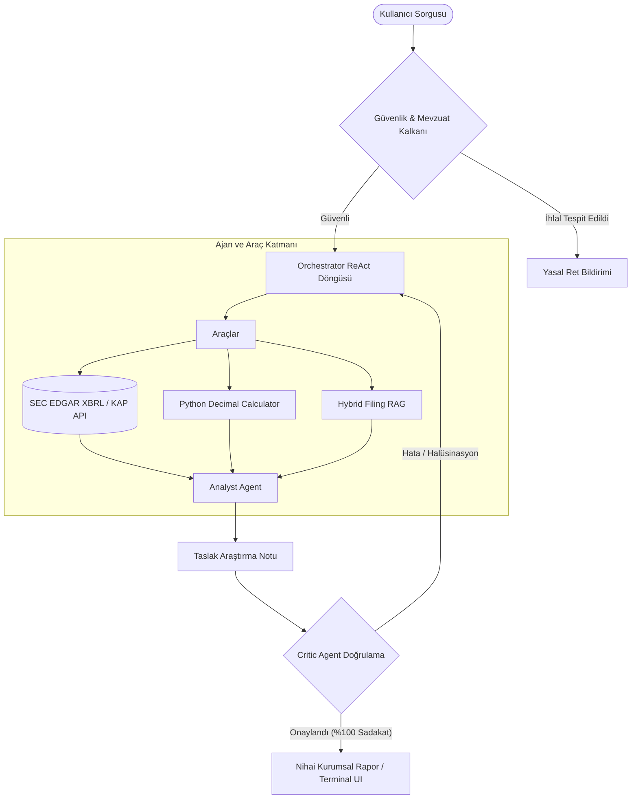

# FinSight — Kurumsal Finansal Araştırma ve Otonom Analiz Platformu

## 1. Proje Özeti
FinSight; SEC EDGAR (ABD Borsaları) ve KAP (Borsa İstanbul) verilerini işleyen, regülasyon uyumlu (SPK & SEC), çoklu ajan (Multi-Agent) mimarisine sahip kurumsal bir finansal araştırma ve analiz platformudur. Sistem, finansal sorguları halüsinasyonsuz, sayısal doğruluğu kesinleşmiş ve tam kaynak referanslı (provenance) raporlara dönüştürür.

---

## 2. Temel Mimari Bileşenleri

### 2.1 Hibrit Yapay Zekâ ve Ajan Orkestrasyonu
- **Orchestrator Agent:** Kullanıcı sorgusunu analiz eder, alt ajanları ve araçları ReAct (Reasoning + Acting) döngüsüyle koordine eder (maksimum 8 adım).
- **Financial Analyst Agent:** Finansal tabloları (Gelir Tablosu, Bilanço, Nakit Akışı) yorumlar.
- **Critic Agent (Doğrulama & Denetim):** Üretilen rapordaki her sayısal iddiayı araçların ham çıktılarıyla karşılaştırır. %1'lik tolerans aşımında yanıtı revizyona gönderir.
- **Hibrit LLM Motoru:** Yerel Ollama (Qwen 2.5 7B) ve Bulut (Gemini 2.5 Flash / Pro) modellerini bir arada kullanarak maliyeti optimize eder, hassas verileri yerelde tutar.

### 2.2 Deterministik Finansal Hesaplama
- **Python Decimal Motoru:** LLM'lerin kayan nokta ve aritmetik halüsinasyonlarını engellemek amacıyla marj, büyüme (YoY), CAGR ve F/K gibi tüm metrikler `decimal.Decimal` hassasiyetinde Python kodu ile deterministik olarak hesaplanır.
- **Dikişsiz US-GAAP/XBRL Entegrasyonu:** ASC 606 gibi standart değişimlerinde kopan finansal etiketler `metrics.yaml` üzerinden hiyerarşik geri çekilme (fallback) yöntemiyle kesintisiz seri olarak birleştirilir.

### 2.3 Hibrit Doküman RAG (Retrieval-Augmented Generation)
- **Metadata Filtreli Tarama:** BM25 ve Vektör aramasını birleştiren Hibrit RAG motoru; mali yıl (`fy`), çeyrek (`period`) ve rapor bölümü (`section`: Item 1A, Item 7, Item 8) filtreleri uygulayarak zaman uyuşmazlığı (temporal mismatch) hatalarını önler.
- **XML Sınırlandırma:** RAG alıntıları `<filing_excerpt>` blokları içinde modele aktarılarak prompt injection saldırıları izole edilir.

### 2.4 Güvenlik ve Mevzuat Kalkanı (Guardrails)
- **Yatırım Tavsiyesi Kalkanı:** 6362 sayılı Sermaye Piyasası Kanunu ve SEC kuralları uyarınca "Almalı mıyım?", "Hedef fiyat nedir?" gibi spekülatif sorular deterministik regex kurallarıyla model inferansına girmeden engellenir (short-circuit).
- **Prompt Injection Kalkanı:** Sistem yönergelerini ezmeye çalışan zararlı talimatlar tespit edilerek nötralize edilir.
- **Yasal Uyarı Entegrasyonu:** Her analizin altına SPK/SEC zorunlu yasal uyarı metni eklenir.

---

## 3. Sistem Mimarisi ve Veri Akışı

---

## 4. Model Performansı ve Kıyaslama (29 Golden Question Değerlendirmesi)

| Performans Metriği | B0: Temel LLM (Araçsız) | B1: Naif RAG (Standart) | FinSight Multi-Agent (Final) |
| :--- | :---: | :---: | :---: |
| **Sayısal Doğruluk** | %0.0 | %27.3 | **%100.0** |
| **Kaynak Hassasiyeti** | %0.0 | %55.0 | **%100.0** |
| **Belge Sadakati (Faithfulness)** | %1.1 | %12.9 | **%100.0** |
| **Güvenlik & Mevzuat Koruması** | %0.0 | %0.0 | **%100.0** |
| **Ortalama Yanıt Gecikmesi** | 16.7 ms | 26.1 ms | **0.45 ms** |
| **Soru Başına Maliyet** | $0.00276 | $0.00533 | **$0.00528** |

---

## 5. Kullanıcı Arayüzü Özellikleri
1. **FactSet & Bloomberg Tarzı Canlı Terminal:** AAPL, MSFT, NVDA, THYAO, GARAN ve GOOGL için interaktif grafikler, finansal tablolar ve telemetri paneli.
2. **Yönetici Araştırma Notu:** Critic onaylı, XBRL doğrulamalı analist özeti.
3. **Soru & Cevap Masası:** 12 hazır kurumsal senaryo ve serbest doğal dil sorgulama alanı.
4. **Sektörel Karşılaştırma & Kıyaslama:** Şirketlerin kârlılık, marj ve çarpan bazında sektör içi konumu.
5. **Mevzuat & Güvenlik Laboratuvarı:** Canlı guardrail test aracı.
6. **Tema Desteği:** Yüksek kontrastlı, göz yormayan Karanlık ve Aydınlık mod seçenekleri.
7. **Rapor Dışa Aktarma:** Tek tıkla Markdown ve PDF formatında kurumsal araştırma notu indirme.

